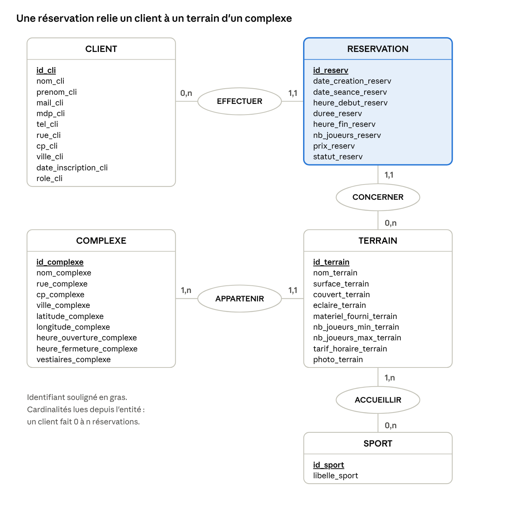

# Arena — MCD et MLD

Cinq entités (Client, Complexe, Terrain, Sport, Réservation), quatre associations, six tables.

## Règles de gestion

1. Un client peut faire aucune ou plusieurs réservations ; une réservation est faite par un seul client.
2. Une réservation porte sur un seul terrain ; un terrain peut n'avoir jamais été réservé, ou l'avoir été plusieurs fois.
3. Un terrain appartient à un seul complexe ; un complexe contient au moins un terrain.
4. Un terrain accueille au moins un sport, parfois plusieurs (un gymnase sert au basket, au volley et au badminton) ; un sport peut être proposé sur plusieurs terrains, ou sur aucun pour l'instant.
5. Les horaires d'ouverture sont ceux du complexe, identiques tous les jours en V1.
6. Le prix d'une réservation est calculé à partir du tarif du terrain, puis enregistré : si le tarif change, les anciennes réservations gardent leur prix.
7. Le nombre de joueurs d'une réservation est compris entre le minimum et le maximum du terrain.
8. Un créneau est libre s'il n'existe aucune réservation « confirmée » sur le même terrain qui le chevauche. La disponibilité se calcule, elle n'est pas stockée.
9. Une réservation annulée n'est pas supprimée : son statut passe à « annulée ».

## MCD

| Association | Cardinalités |
| --- | --- |
| EFFECTUER (Client – Réservation) | 0,n – 1,1 |
| CONCERNER (Réservation – Terrain) | 1,1 – 0,n |
| APPARTENIR (Terrain – Complexe) | 1,1 – 1,n |
| ACCUEILLIR (Terrain – Sport) | 1,n – 0,n |

## MLD

Clé primaire en **gras** (soulignée sur papier), clé étrangère précédée de **#**.

- CLIENT (**id_cli**, nom_cli, prenom_cli, mail_cli, mdp_cli, tel_cli, rue_cli, cp_cli, ville_cli, date_inscription_cli, role_cli)
- COMPLEXE (**id_complexe**, nom_complexe, rue_complexe, cp_complexe, ville_complexe, latitude_complexe, longitude_complexe, heure_ouverture_complexe, heure_fermeture_complexe, vestiaires_complexe)
- SPORT (**id_sport**, libelle_sport)
- TERRAIN (**id_terrain**, nom_terrain, surface_terrain, couvert_terrain, eclaire_terrain, materiel_fourni_terrain, nb_joueurs_min_terrain, nb_joueurs_max_terrain, tarif_horaire_terrain, photo_terrain, #id_complexe)
- ACCUEILLIR (**#id_terrain, #id_sport**)
- RESERVATION (**id_reserv**, date_creation_reserv, date_seance_reserv, heure_debut_reserv, duree_reserv, heure_fin_reserv, nb_joueurs_reserv, prix_reserv, statut_reserv, #id_cli, #id_terrain)

## Contraintes

| Table | Contrainte |
| --- | --- |
| CLIENT | `mail_cli` unique ; `role_cli` vaut « client » ou « admin » |
| TERRAIN | `nb_joueurs_min_terrain` ≤ `nb_joueurs_max_terrain` ; `tarif_horaire_terrain` ≥ 0 (0 = gratuit) |
| ACCUEILLIR | Clé primaire composée (`id_terrain`, `id_sport`) |
| RESERVATION | `statut_reserv` vaut « confirmée », « annulée » ou « terminée » ; `duree_reserv` > 0 ; pas de chevauchement avec une réservation confirmée du même terrain (vérifié par l'application) |
| Toutes | On ne supprime pas un complexe, un terrain ou un client qui a des réservations |

Script de création : [`../database/arena.sql`](../database/arena.sql).
